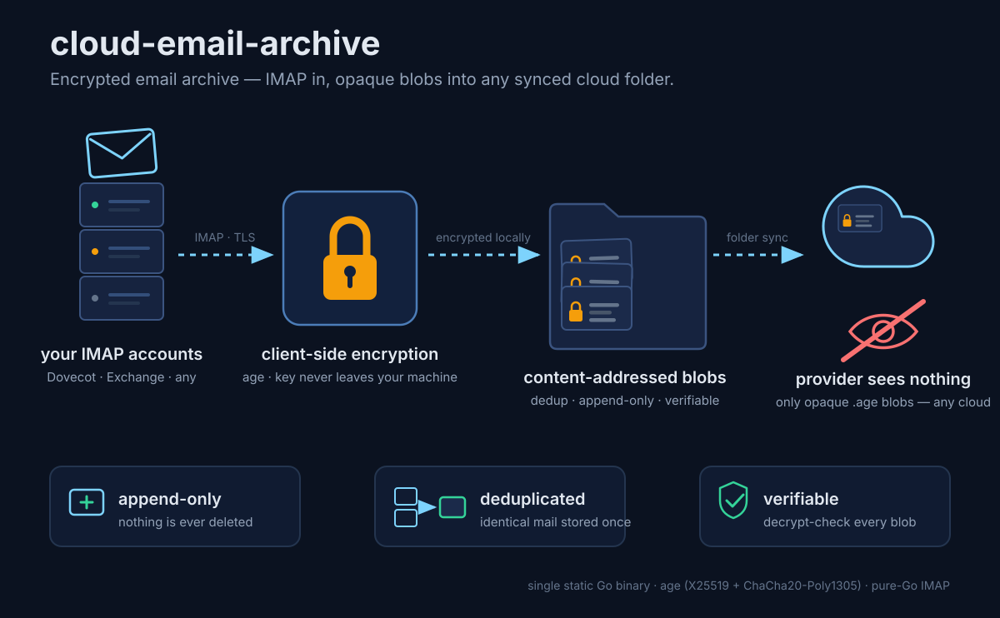

# cloud-email-archive



A single static Go binary (no runtime dependencies): fetches email via IMAP
(Dovecot, Exchange, … — as many accounts as you like), encrypts it client-side
with [age](https://age-encryption.org), and stores it as content-addressed
blobs in a folder that your cloud sync/mount pushes to the provider —
Nextcloud, Syncthing, Dropbox, OneDrive, Google Drive, Seafile, an SMB/NFS
share, an `rclone` mount, or a plain USB drive.

```
IMAP (account 1..n: dovecot, exchange, …)
   │  cloud-email-archive sync   ── plaintext only in RAM
   ▼
age-encrypted blobs
   ▼
~/Nextcloud/email-archive/     ── any sync client/mount uploads opaque .age files
```

**Threat model:** the provider sees only encrypted blobs with cryptographic
names. No content, no subject lines, no senders, no folder structure. Content
addressing (filename = SHA-256 of the plaintext) makes deduplication pay off:
identical mails (e.g. in several folders or accounts) are stored once, and a
re-run only fetches mails that don't exist yet — incremental, like a backup
tool. Data is protected two ways: age is authenticated, any
modification shows up in `verify` — and verify also checks the
content-addressing guarantee itself (filename must equal the SHA-256 of the
decrypted mail), catching renames, copy bugs, or provider-side mangling.

## Build

```sh
go build -o cloud-email-archive .   # single binary, cross-compilable (linux/darwin/windows)
```

## Setup (once)

```sh
cp config.example.toml ~/.config/cloud-email-archive/config.toml
# Fill in your accounts (as many as you like). Password alternatives:
#   password = "..."  or  password_cmd = "cat ~/.config/imap-passwords/faculty"

cloud-email-archive keygen    # creates ~/.config/cloud-email-archive/key.txt  (IMPORTANT: back it up!)
cloud-email-archive sync      # first run
cloud-email-archive list      # sanity check: headers of archived mails
```

Point `archive_dir` in the config at a folder inside your synced/mounted share
(`~/Nextcloud/…`, `~/Sync/…`, `/mnt/share/…`, whatever your provider gives you).
Paths can be overridden in the TOML or via `-config FILE`;
`CLOUD_EMAIL_ARCHIVE_CONFIG` sets the default config location.

## Usage

```sh
cloud-email-archive sync    [-account NAME]         # fetch IMAP + encrypt (incremental)
cloud-email-archive list    [-account NAME] [-limit 20]
cloud-email-archive search  [-account NAME] TERM    # full-text search over decrypted mails
cloud-email-archive extract [-dir OUT] [-account NAME]   # write decrypted .eml files
cloud-email-archive verify  [-account NAME]         # decrypt + hash-check every blob
cloud-email-archive keygen  [-output FILE]
```

## Operation / Automation

```sh
crontab -e
# e.g. daily at 03:00:
0 3 * * * $HOME/cloud-email-archive sync >> "$HOME/cea-sync.log" 2>&1
# monthly integrity check:
@monthly $HOME/cloud-email-archive verify >> "$HOME/cea-verify.log" 2>&1
```

## Principles

- **Append-only:** nothing is ever deleted. Even if a mail disappears from the
  server, it stays in the archive — as an archive should.
- **No `\Seen` flag:** FETCH runs with `BODY.PEEK`; your inbox on the server
  stays untouched.
- **Incremental & resumable:** UID/UIDVALIDITY progress in `state.json`; on
  UIDVALIDITY change the folder is cleanly re-fetched. Interrupted runs simply
  continue where they left off.
- **Provider-agnostic:** the archive is just files in a folder. Any storage
  that can sync or mount a directory works — no provider API in the binary.
- **Account types optional:** `[[accounts]]` is a generic list. Dovecot and
  Exchange are just examples — any IMAP account works, in any combination.

## Recovery

The key is `~/.config/cloud-email-archive/key.txt`. **Without this key the
archive is unreadable** — keep a copy in your password manager. To restore on
another machine: drop binary + `config.toml` + `key.txt`, run
`cloud-email-archive extract`/`list` against the synced archive folder.

## Details

- IMAP client: [`emersion/go-imap/v2`](https://github.com/emersion/go-imap) (pure Go)
- Encryption: [`filippo.io/age`](https://age-encryption.org/v1) (X25519/ChaCha20-Poly1305, audited)
- Config: TOML
- Further architecture decisions: see `docs/arc42/`
